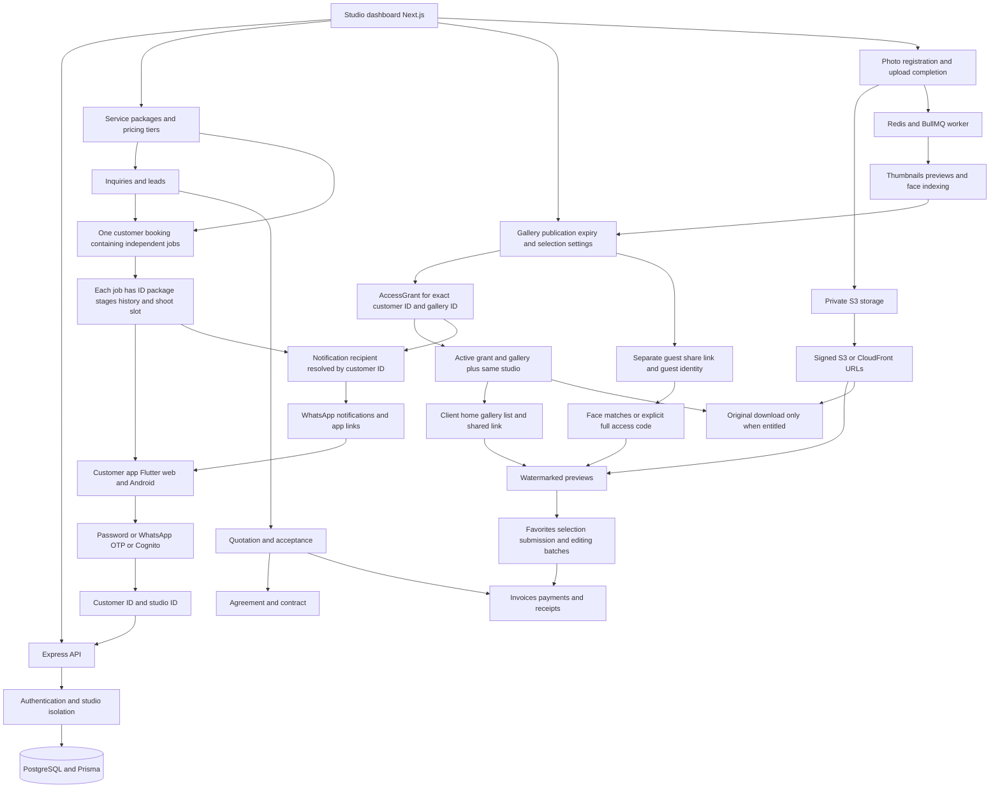

# Booking timelines and gallery access incident

The investigation covers the studio dashboard, customer web and Android app, API, database, photo pipeline, sharing, and notifications. The reported failures concern independent shoot timelines and galleries that appear assigned in the studio but cannot be opened by clients.

## Application context graph

An app link identifies a gallery; it does not grant access. An assignment must create an AccessGrant for the account that authenticates. A published gallery can still be unavailable because its expiry or the grant expiry has passed. Guest access uses its own share session and must not silently become client selection access.

## Confirmed defects

1. The dashboard renders multiple timelines but timeline clicks omit jobId. The API silently selects job zero when an ID is omitted or invalid. Advancing S2 can change S1 instead.
2. Shoot-time edits and reschedule requests update the shared booking and newest lead, without updating the selected job. The client reads job snapshots and can show stale slots or slots for the wrong shoot.
3. Package assignment updates the shared servicePackageId while saved job package names and stages remain stale.
4. Gallery assignment writes a grant and reports success regardless of publication or gallery expiry. It can notify a client about a gallery that the API will refuse to open.
5. Client home omits gallery expiry checks applied by the gallery list and detail API, so it can advertise an unavailable gallery.
6. The generic gallery denial tells clients to use another account even when the actual problem is publication or expiry.
7. Concurrent booking JSON writes can overwrite sibling job changes.
8. Phone login can select a guest record sharing a client's phone, or the wrong phone-format variant. The real client's grants belong to a different customer ID. Previously issued ordinary client tokens for guest records can keep this incorrect identity alive.
9. A cached private home response can hide a newly assigned gallery for up to 60 seconds. The Flutter shell also keeps its gallery provider alive when navigating between tabs.
10. Favorites, completed face-search results, and established guest sessions can retain access after expiry or share revocation because they do not all recheck current availability.
11. The first client Book Now request also assigns package pricing, which can create a package timeline before the request creates its enquiry timeline. One shoot can therefore appear twice. Pricing synchronization now leaves job creation to the booking request.
12. Creating a client with initial gallery choices silently skips unavailable galleries. The account creation appears successful even when its selected assignment was not created. Account creation and initial grants are now atomic, and an unavailable choice rejects the request before creating the account.
13. Quotation conversion reads only saved jobs. A previous booking represented by the legacy shared fields can be lost when converting a new quotation. Conversion now reconstructs that existing timeline before adding the new shoot.

## Production observations

Read-only inspection found multiple jobs in three customer bookings, stale legacy package snapshots, and non-guest grants attached to draft or expired galleries. Cognito is disabled in this deployment; the active customer login path uses local account IDs. These observations establish failure mechanisms but do not identify the unnamed client mentioned in the report.

### Existing unavailable assignments

The inspection found **11 real-client assignments across six unavailable galleries**. Five galleries had expired; the sixth was a draft. Dates below are UTC. Identical gallery names refer to different gallery IDs.

| Gallery | Gallery ID | Clients with grants | Saved blocker |
| --- | --- | --- | --- |
| RAW GALLERY | `a426cce5-9ece-4446-a24e-1fb727e20f73` | puja Rathore | Gallery expired October 4 |
| Out Door RAW Gallery | `cf1fad2b-949c-4d0f-b1f1-42d76431b706` | Sj, Viru | Gallery expired October 7 at 00:00 UTC |
| Edited Gallery | `db0227c5-f9fc-41d8-aca9-dfe7ff0a8ad4` | Sj, virbhadra gudup | Gallery expired October 6 |
| RAW GALLERY | `205a20d2-1c7e-49bf-9d19-fafc96f93e2f` | Sj, Sagar More, Suyog | Gallery expired October 3 |
| RAW GALLERY | `3715d898-89f8-42b8-a65a-cc378c277d92` | Viru, Sj | Gallery expired September 30 |
| UPDATED GALLERY | `3c08671f-256c-47a3-9595-da6f0f998a51` | Suyog | Draft, not published |

There are also normalized-phone collisions involving guest and real-client records, including two groups containing multiple real-client records. The login fix excludes guests and prefers a uniquely issued login ID. Ambiguous real-client accounts have not been merged.

Legacy package snapshots differ from the shared booking for Viru, Vijaysingh patil, and Sj. The code now writes consistent jobs for new changes. Historical packages and stages have not been rewritten because the old data does not establish whether the studio intended a package replacement or an additional shoot.

A further read-only check found older July/August BOOK leads without an explicit job ID in the current booking JSON. Among them are accepted requests for nivas salla (July 25, two requests) and Sj (August 18). These predate the saved multi-job requests and may be represented by a legacy shared timeline. Historical stages cannot safely be attributed to each lead automatically. Also, sai panchal's multi-job record belongs to a guest identity; it is outside the real-client login audit.

## Implemented changes

### Independent shoots

- Shared booking helpers preserve each job's metadata, stages, history, package, and schedule. Jobs receive stable S1/S2 labels based on creation order.
- Stage, slot, and reschedule actions require the exact job ID whenever multiple jobs exist. Unknown IDs return 404; ambiguous requests return 409. They cannot silently update S1.
- Dashboard timeline clicks, stage forms, and slot forms carry the selected job ID. The dashboard provides an explicit **Add another shoot** choice, including another shoot using the same package.
- Client booking cards show each shoot's schedule and reschedule action. S2's request changes S2 and its matching enquiry, while preserving S1.
- Lead acceptance synchronizes its corresponding job. Package assignment updates a matching job, fills an unassigned placeholder, or adds a distinct package job. Repeating the same assignment does not duplicate jobs.
- A client's first Book Now request creates exactly S1, and a second request using the same package creates exactly S2. Automatic pricing setup does not create an extra timeline.
- Quotation conversion preserves an earlier legacy shoot and adds the new quote job as S2 once, including concurrent conversion retries. Invoice and agreement metadata remain attached to the new job.
- Booking JSON writes lock the customer row within a database transaction so simultaneous edits cannot discard sibling jobs.

Main implementation: [bookingJobs.js](../backend/src/services/bookingJobs.js), [bookingMutation.js](../backend/src/services/bookingMutation.js), [packageSync.js](../backend/src/services/packageSync.js), [portal.js](../backend/src/routes/portal.js), [dashboard bookings](../admin-dashboard/src/app/dashboard/bookings/page.tsx), [client booking screen](../customer-app/lib/screens/booking_screen.dart).

### Assignment, identity, and access

- Both the gallery assignment screen and client assignment screen use one transactional assignment service. It validates every selected client and gallery against the same studio before writing any grants.
- **Assign and publish** publishes a draft and creates or renews its grants atomically. The interface explains publication. Expired, archived, deleted, foreign-studio, guest, disabled, or invalid targets cannot produce a successful assignment response.
- An expired gallery must first have its gallery expiry extended. Renewing a client grant alone cannot override the gallery's expiry.
- Dashboard assignment lists show whether access is available and the reason when blocked.
- Creating a new client with initial gallery assignments validates every chosen gallery and creates the account and grants in one transaction. Unavailable selections cannot be silently dropped.
- Client home and gallery listing apply the same publication, gallery expiry, grant expiry, deletion, and tenant rules. Private home data is fetched fresh; the client refreshes galleries when reopening the tab or resuming the app.
- Gallery detail and download APIs distinguish not assigned, unpublished, expired gallery, expired access, and removed gallery. Clients receive the actual reason instead of being told to use another account for every failure.
- Phone login excludes guest identities, prefers a uniquely issued login ID, and rejects ambiguous phone matches. Old ordinary client sessions backed by guest records must sign in again.
- Favorites and face results recheck current access. Guest sessions recheck share activity and expiry. The face worker and notification recipient queries exclude expired or deleted galleries.
- SELECTION, VIEW, RAW, payment/download, and guest face/full-access entitlements remain separately enforced. A client deep link does not confer permission.

Main implementation: [galleryAssignment.js](../backend/src/services/galleryAssignment.js), [galleryAccess.js](../backend/src/services/galleryAccess.js), [gallery routes](../backend/src/routes/gallery.js), [admin routes](../backend/src/routes/admin.js), [authentication](../backend/src/routes/auth.js), [guest sharing](../backend/src/routes/share.js), [client shell](../customer-app/lib/screens/shell_screen.dart).

## Verification

| Check | Result | What it establishes |
| --- | --- | --- |
| Backend `npm test` | PASS: 21 test files, zero failures | Existing regressions plus job serialization, ID validation, labeling, and availability helpers |
| Real HTTP API integration against isolated PostgreSQL | PASS | Real authentication, transactions, and database queries; all cases listed below |
| Dashboard TypeScript check | PASS | Changed dashboard code type-checks |
| Production backend and dashboard Docker builds | PASS | Release images build successfully |
| Flutter analysis | PASS: no issues | Shared client code analysis |
| Flutter tests | PASS: four tests | Existing navigation and share-link regressions |
| Flutter web release build | PASS | Rebuilt client web artifact |
| Dashboard browser regression | PASS | Actual S2 timeline click and slot form send S2's ID; explicit S3; assignment failure remains visible; successful assignment publishes; mobile layout fits |
| Rebuilt Flutter browser regression | PASS | Separate S1/S2 cards, S2 reschedule packet, unchanged S1, new assignment appears after reopening Galleries |

The API integration covers guest versus real-client phone identity, canonical login IDs, rejection of old guest client sessions, first and second real Book Now requests, preservation of a legacy shoot during concurrent quotation conversion, S1/S2 creation, independent stage and schedule edits, concurrent sibling changes, explicit job errors, lead acceptance, reschedule isolation, idempotent package assignment, and studio isolation. Gallery cases cover both assignment surfaces, new-client creation with initial assignments, atomic publication, immediate home/list/detail access, selection submission, renewal, precise expiry errors, wrong-account denial, VIEW/RAW permissions, favorites and face-result filtering, and guest expiry/revocation/deletion.

API tests use a dedicated disposable test database, with S3, queue, and messaging substitutes; they do not send clients notifications. Browser tests use actual application builds with controlled API responses. They verify interface wiring separately from the real-database integration tests. They do not prove delivery of a real WhatsApp message, a live Rekognition match, or a new APK installation.

Regression sources: [bookingJobs.test.js](../backend/tests/bookingJobs.test.js), [API integration](../backend/tests/booking-gallery.integration.js), [dashboard browser checks](../tests/booking-gallery-admin.browser.cjs), [client browser checks](../tests/booking-gallery-client.browser.cjs).

## Production release and follow-up

The backend, worker, dashboard, and Flutter web app were deployed on October 7, 2026, at **13:53:30 UTC**. Public backend readiness and dashboard login checks passed, and the publicly served `main.dart.js` exactly matched the rebuilt client artifact. All production services reported healthy after rollout.

The first post-deployment read-only audit exercised existing client identities against the running API:

- **77 active real-client accounts** with bookings or grants checked.
- **98 active gallery assignments** appeared correctly and opened successfully.
- Home galleries matched the newest six active grants; gallery lists matched every active grant.
- **11 unavailable assignments** returned the precise expiry or unpublished reason shown in the table above.
- Both eligible real-client bookings with multiple saved jobs returned all job IDs and stable shoot labels.

The additional backend fixes for first Book Now, new-client initial assignment, and legacy quotation conversion were deployed after their expanded integration checks passed. Final verification completed at **14:04:16 UTC**. The final production audit repeated all 77 account checks and all 98 active gallery opens successfully. It also fetched **144 signed thumbnail/preview assets across 72 distinct galleries**: no failed asset requests, missing sampled display URLs, or galleries without visible photos. This checks representative real S3/CDN delivery in addition to API access; it is not an audit of every stored photo.

Rollback images, a PostgreSQL backup, previous web assets, and the rollback command are retained under `.releases/booking-gallery-20261007-135201/`. Docker's prior image layers were missing, so the healthy running containers were exported into restorable images; both rollback runtimes were checked before replacement. No rollback was needed. The initially deployed fixed backend is additionally tagged `sj-studio-backend:booking-gallery-first-20261007`. The final audit evidence and deployment timestamp are saved as `final-live-account-audit.json` and `final-backend-deployed-at` in that release directory.

No database migration is required. Existing customer records, gallery expiry dates, assignments, and historical booking stages are preserved. The source tree already contained substantial prior changes; they were preserved. The original backend files were compared with the running deployment before the task changes.

To restore access for an expired gallery in the table: extend its gallery expiry, then assign the intended client through **Assign and publish** to renew any expired grant. For the draft, confirm its contents are ready and use **Assign and publish**. If a client remains signed into a previously selected guest identity, they must sign out and sign in with the issued client login ID.

The user has not yet provided the specific affected client and gallery, so that exact reported account cannot be identified. The expired records above remain blocked by their saved dates until renewed; they are not described as repaired by the code release. Historical package mismatches and duplicate real-client identities also require a record-specific decision. The native Android source is fixed and analyzed, but an installed Android app receives these UI changes only through a new APK release.
