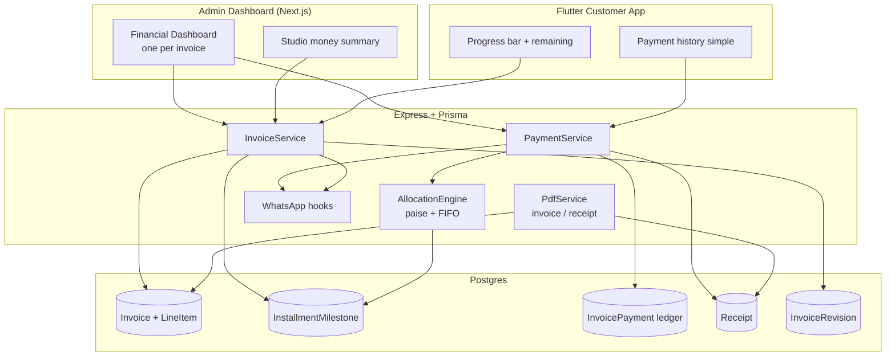
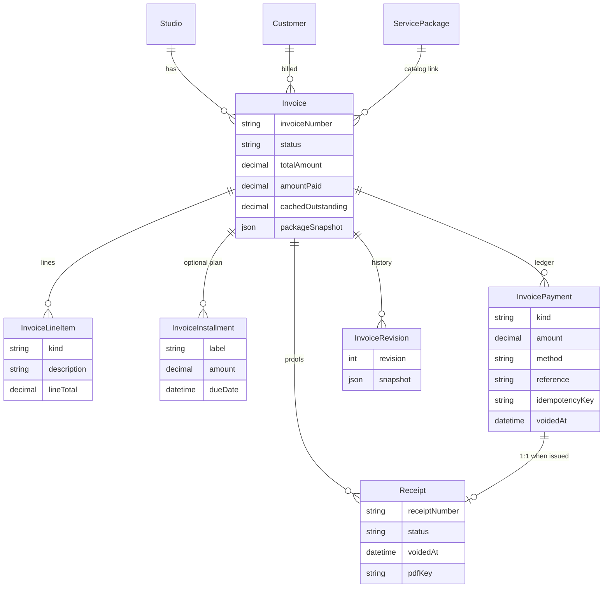
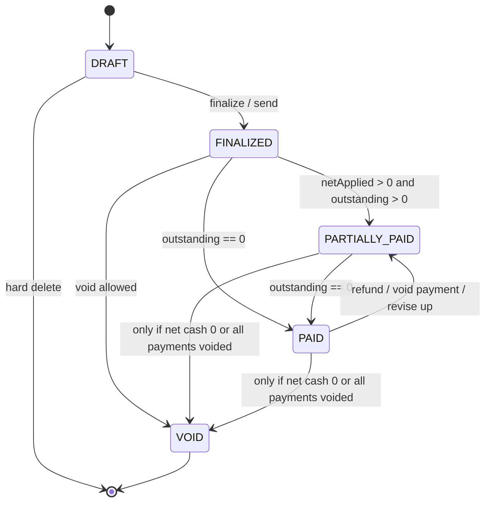
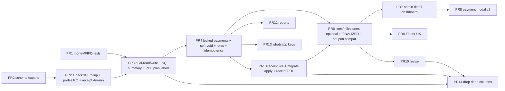

# Invoice & Payment Architecture Redesign

| Field | Value |
|-------|--------|
| **Document** | Invoice & Payment Architecture (First Principles) |
| **Author** | Studio Platform Engineering |
| **Date** | 2026-07-22 |
| **Status** | Draft (Revision 3 — re-review edge cases addressed) |
| **Codebase** | `/home/ubuntu/sj/studio-platform` |
| **Primary surfaces** | `backend/prisma/schema.prisma`, `backend/src/routes/billing.js`, `admin-dashboard/.../invoices/page.tsx`, `customer-app/lib/screens/invoices_screen.dart`, `backend/src/services/invoicePdf.js` |

---

## Overview

SJ Studio / Warmkelvin is a multi-tenant photography studio SaaS. Today billing is **installment-centric**: paid amounts are stored on the invoice *and* each installment *and* the payment ledger; receipts are fake child `Invoice` rows (`kind=RECEIPT`); free-form Indian cash flows (₹40k + ₹20k + … against a 43/43/39 plan) do not waterfall correctly because allocation only sums rows that already carry `installmentId`.

This design re-centers the domain on one immutable fact chain:

**Package (what was sold) → Invoice (the bill) → Payment ledger (`InvoicePayment`, evolved in place) → Outstanding Balance (always computed).**

Installment plans become optional **reminders / planned milestones**. Outstanding is never manually edited. Payments are never updated in place; corrections are new ledger entries (refund / adjustment / write-off) or soft-void. Receipts become first-class documents generated from payments, not sibling invoices.

**API naming:** responses and services speak of “payment transactions.” **DB table stays `InvoicePayment`** (evolved in place) to avoid a heavy table rename. Commerce `Payment` (orders/frames, `Decimal(10,2)`) remains a separate domain forever in v1.

---

## Background & Motivation

### Current state (as implemented)

| Area | Reality today | Pain |
|------|---------------|------|
| **Source of truth** | Mixed: `Invoice.amountPaid`, `InvoiceInstallment.paidAmount` / `status` / `paidAt`, and `InvoicePayment` ledger | `mapInvoice` / `recomputeInvoiceBalances` prefer ledger when present, else columns — dual paths drift |
| **Receipts** | `Invoice.kind = RECEIPT` with `parentInvoiceId`, fake single installment, own invoice number | Clutters list (default filter hides them); PDF/list logic must special-case |
| **Allocation** | Payments bind to `installmentId`; auto-pick is *first open installment only*, not FIFO waterfall of remaining amount | ₹40k against 43k+43k+39k marks only first installment partially; unallocated cash does not roll forward |
| **Create flow** | 1–5 installments **required**; percentages ignored (`normalizeAmountInstallments`) | UX forces schedule even when studio only cares about total |
| **Package** | Live `packageId` FK to `ServicePackage` — no line-item snapshot | Package price edits rewrite history; no add-on / discount lines |
| **Customer denorm** | `Customer.paymentTotalDue` / `paymentAmountPaid` overwritten from **that invoice only** on each recompute (`billing.js` L232–238, L1065–1072) | Multi-invoice clients get wrong profile totals; admin free-text edit on client profile competes as SoT |
| **Dual payment systems** | Commerce `Payment` (orders/frames, **Decimal(10,2)**) vs `InvoicePayment` (**Decimal(12,2)**) | Naming collision; different precision; no shared money primitives |
| **Mutability** | `DELETE /invoices/:id/payments/:paymentId` hard-deletes ledger rows | Breaks audit; no idempotency keys |
| **PDF** | Invoice PDF shows installment statuses as if they were cash truth | No separate receipt PDF |
| **Roles** | Team UI copy says “Manager — full access except billing” | **API does not enforce**: `billing.js` uses only `authenticateAdmin`; `requireRole` exists in `middleware/auth.js` but is used on team/audit routes in `admin.js`, not billing. STAFF/MANAGER/OWNER all can pay/void/delete today |

Key code anchors:

- Schema: `Invoice`, `InvoiceInstallment`, `InvoicePayment` — `backend/prisma/schema.prisma` (~L328–417)
- Balance recompute groups only by `installmentId` — `recomputeInvoiceBalances` in `billing.js` L158–245
- Receipt helper — `createPaymentReceipt` L286–331 is **dead code** (defined, never called from current payment handlers). Historical `kind=RECEIPT` rows may still exist in DB from earlier builds
- Admin create requires installment sum — `admin-dashboard/.../invoices/page.tsx`
- Customer UI already titled “Payments” but still shows installment accounting jargon — `invoices_screen.dart`
- Coupon eligibility hard-coded to `status == 'SENT'` — `invoices_screen.dart` ~L418–421 and customer apply-coupon route

### Indian payment reality (must support)

Package agreed: **₹1,25,000** planned as **43k + 43k + 39k**. Actual cash:

```
40k, 20k, 25k, 15k, 10k, 15k  (multiple days, skips, prepay, multi-admin)
```

System must:

1. Accept any positive amount ≤ remaining due (or allow overpay with explicit `allowOverpay: true`).
2. Never require the admin to pick an installment for correctness.
3. Automatically **FIFO-allocate** applied balance across milestones for display / reminders only.
4. Keep `Outstanding = InvoiceTotal − NetApplied` exact to the paise.

### Why now

Ledger was introduced (`20260721_invoice_payment_ledger`) as a partial fix, but installments remain co-equal source of truth. Without a clean cut, every new feature (GST fields, online pay hooks, multi-invoice clients, reports) multiplies inconsistency.

---

## Goals & Non-Goals

### Goals (v1)

1. **Single financial source of truth**: Invoice total (from line items) + immutable payment ledger → computed outstanding.
2. **Installments demoted** to optional schedule; no stored `paidAmount` as authority.
3. **FIFO waterfall** onto milestones for UI/reminders only (see D16 for cash vs net).
4. **Receipts** as documents derived from payments — not `Invoice` children.
5. **Package / line-item snapshot** on the invoice at finalize time.
6. **Idempotent payment recording** (`idempotencyKey` + studio scope) under row lock.
7. **Immutable payments**; soft-void + refund/adjustment; no hard delete in prod.
8. **One admin financial dashboard** per invoice.
9. **Simple customer UX**: progress bar, “paid / remaining”, no PARTIAL/WAIVED jargon.
10. **Feature-flagged migration** without data loss; dual-write until contract.
11. **Multi-tenant** isolation by `studioId` on every money table.
12. **Money**: `Decimal(12,2)` at rest; **integer paise** in algorithms (no `Number(decimal)` path).
13. **Role-gated** cash controls (STAFF record payments; MANAGER+ refund/void/revise/write-off).

### Non-goals (v1)

- Razorpay / PayU / Stripe live capture (optional nullable gateway columns only; no state machine, no write paths).
- Multi-currency as first-class product (INR primary; `currency` string retained).
- Full GST e-invoice / IRN / e-way (optional GSTIN / HSN columns only).
- Merging commerce frame `Order`/`Payment` into invoice ledger.
- Automated dunning beyond WhatsApp hooks.
- Cross-invoice wallet / applying overpay to a later invoice.
- `bookingId` on Invoice (not wired to `CustomerBooking` in v1 — drop from schema).

---

## Proposed Design

### First principles

```
┌─────────────┐     finalize      ┌──────────────┐
│   Package   │ ───────────────►  │   Invoice    │  line items SoT for total
│ (catalog)   │                   │  (the bill)  │  + packageSnapshot
└─────────────┘                   └──────┬───────┘
                                         │
              optional schedule          │  1:N immutable
         ┌───────────────────────┐       │
         │  Installment milestones│       ▼
         │  (reminders only)     │  ┌──────────────┐
         └──────────┬────────────┘  │ InvoicePayment│  DB table (evolved)
                    │               │  append-only  │
                    │  derived      └──────┬───────┘
                    ▼                      ▼
              ┌──────────────────────────────────┐
              │  Outstanding = Total − NetApplied│
              │  Milestone progress = FIFO(view) │
              └──────────────────────────────────┘
                         │
                         ▼
                   ┌──────────┐
                   │ Receipt  │  1:1 with PAYMENT when issued
                   └──────────┘
```

**Invariants (enforced in service layer + nightly reconcile):**

| # | Invariant |
|---|-----------|
| I1 | `outstandingPaise = max(0, totalPaise − netAppliedPaise)` — never a client-writable authority. Cache columns are write-through mirrors only. |
| I2 | Payment rows are append-only; amount/kind never UPDATEd; mistakes use soft-void or compensating entries |
| I3 | **Partial plans allowed:** if milestones exist, `0 < sum(plannedAmount) ≤ totalAmount` within 1 paise. Unscheduled remainder is an **implicit final bucket** for FIFO (not “credit”) |
| I4 | Net applied / cash paid defined in § Net payment definition; raw net never clamped for storage |
| I5 | All money ops scoped by `studioId`; customer cannot create payments |
| I6 | Invoice number unique per studio; receipt number unique per studio (separate sequences) |
| I7 | Once finalized (`finalizedAt` set), total/lines change **only** via `POST …/revise` (not bare `PUT totalAmount`) |
| I8 | `sum(lineItem.lineTotal) == totalAmount` after every create/revise (line items are SoT for total) |
| I9 | `idempotencyKey` if present: non-blank; unique per studio via partial unique index |

### Source-of-truth matrix (critical)

| Fact | Source of truth | Cached / projected (never authority) |
|------|-----------------|--------------------------------------|
| Invoice total | **Sum of `InvoiceLineItem.lineTotal`** (server-computed on write) | `Invoice.totalAmount` denormalized for queries; must match lines |
| Service / travel / discount breakdown | **Line items** by `kind` | Optional convenience columns `travelAmount`, `discountAmount` written **only** from line aggregation on same write — not independently editable |
| Amount paid / outstanding | **Ledger** (`InvoicePayment` non-voided) | `Invoice.amountPaid` (keep column name for compat) + `Invoice.cachedOutstanding` — updated only inside payment/recompute tx |
| Milestone planned amounts | **`InstallmentMilestone.plannedAmount`** (or evolved `InvoiceInstallment.amount`) | — |
| Milestone “how much covered” | **Pure function** FIFO(cash or net) on read | During dual-write phase only: legacy `paidAmount`/`status` mirrors for old UI |
| Package display history | **`packageSnapshot` JSON** at finalize/revise | Live `packageId` is catalog link only |
| Receipt validity | **`Receipt.voidedAt` / status** | Regenerated PDF reflects void watermark |

**Line totals:** On write, server sets `lineTotal = qty × unitAmount` in paise (signed for DISCOUNT). Do **not** accept client `lineTotal` as independent input. Prefer compute-on-read in DTO; store `lineTotal` only as validated denorm for SQL sums.

**Paise conversion (no float):**

```js
// money.js — ban Number(prismaDecimal) * 100 in this module
function toPaise(value) {
  // Accept Prisma Decimal, string "125000.50", or number from trusted JSON body
  const s = decimalToFixedString(value, 2); // e.g. "125000.50"
  const neg = s.startsWith('-');
  const [w, f = '00'] = (neg ? s.slice(1) : s).split('.');
  const paise = BigInt(w) * 100n + BigInt(f.padEnd(2, '0').slice(0, 2));
  return neg ? -paise : paise;
}
function fromPaise(paise) {
  // Return number for API JSON (existing API contract uses JS numbers)
  const n = Number(paise);
  return Math.trunc(n) / 100;
}
function fromPaiseDecimalString(paise) {
  const sign = paise < 0n ? '-' : '';
  const a = paise < 0n ? -paise : paise;
  const w = a / 100n;
  const f = a % 100n;
  return `${sign}${w}.${f.toString().padStart(2, '0')}`;
}
```

Unit tests in `backend/src/services/billing/__tests__/money.test.js` must cover large INR amounts and reject float drift cases.

### Conceptual separation

| Concept | Owns | Does **not** own |
|---------|------|------------------|
| **Package** (`ServicePackage` catalog) | Title, base price, features, marketing | Payment state, due dates |
| **Invoice** | Bill number, customer, line items, total, lifecycle, terms, snapshot | Installment progress as truth |
| **Installment plan** | Ordered milestones (label, planned amount, due date) | Cash received |
| **Payment** (`InvoicePayment` row) | Amount, paidAt, method, reference, collector, kind, notes | UI schedule |
| **Receipt** | Human-facing proof PDF / number linking to **one** payment | Changing balance |

### Architecture diagram



---

## Multi-admin concurrency (payment write path)

Today’s `POST /invoices/:id/payments` does **no** transaction and **no** lock (`billing.js` ~L920–975): find → create → recompute as separate statements. Two admins can both read outstanding ₹65,000 and both record ₹65,000.

### Algorithm `recordPayment` (normative)

```
function recordPayment(studioId, invoiceId, body, admin):
  // ── normalize idempotency ──
  key = body.idempotencyKey
  if key is string and key.trim() === '':
    return 400 VALIDATION "idempotencyKey must be non-empty when provided"
  if key is string: key = key.trim().slice(0, 128)
  else: key = null

  kind = upper(body.kind || 'PAYMENT')
  amountPaise = toPaise(body.amount)
  if amountPaise <= 0: return 400 VALIDATION

  // Role gate (D18)
  if kind in (REFUND, WRITE_OFF, ROUND_OFF, ADJUSTMENT) and admin.role == STAFF:
    return 403 FORBIDDEN
  // STAFF may only kind=PAYMENT

  try:
    return await prisma.$transaction(async (tx) => {
      // 1) Row lock invoice (Postgres)
      const rows = await tx.$queryRaw`
        SELECT id, status, "totalAmount", "finalizedAt", "sentAt", "customerId", currency
        FROM "Invoice"
        WHERE id = ${invoiceId} AND "studioId" = ${studioId}
        FOR UPDATE`
      if (!rows.length) throw NotFound
      inv = rows[0]
      if inv.status == 'VOID' or inv.status == 'DRAFT' or !inv.finalizedAt:
        throw Validation("Invoice not open for payments")
      // also reject kind=RECEIPT legacy rows if still present

      // 2) Idempotent replay (inside lock — serializes with concurrent first-insert)
      // Partial unique is (studioId, idempotencyKey) — MUST verify invoice match.
      if key != null:
        existing = await tx.invoicePayment.findFirst({
          where: { studioId, idempotencyKey: key }
        })
        if existing:
          if existing.invoiceId != invoiceId:
            throw Conflict("idempotencyKey already used on another invoice")  // 409
          // Same invoice: replay original row (even if voidedAt set — client must use a new key to re-enter)
          full = await loadInvoiceProjection(tx, invoiceId)
          return { payment: existing, invoice: full, replayed: true }

      // 3) Recompute net FROM LEDGER inside tx (ignore cache for authorization)
      payments = await tx.invoicePayment.findMany({
        where: { invoiceId, voidedAt: null }
      })
      money = computeMoney(inv.totalAmount, payments)  // pure; uses toPaise
      displayCash = max(0n, money.cashPaidPaise)

      // Amount caps (D9 / D20) — all kinds
      if kind == 'PAYMENT' and !body.allowOverpay:
        if amountPaise > money.outstandingPaise:
          throw Validation(
            `Amount exceeds outstanding ${fromPaise(money.outstandingPaise)}`,
            { outstanding: fromPaise(money.outstandingPaise) }
          )
      if kind == 'REFUND' and !body.allowNegativeCash:
        // default allowNegativeCash=false — refund cannot exceed cash collected
        if amountPaise > displayCash:
          throw Validation(
            `Refund exceeds cash paid ${fromPaise(displayCash)}`,
            { cashPaid: fromPaise(displayCash) }
          )
      if kind in (WRITE_OFF, ROUND_OFF, ADJUSTMENT) and !body.allowOverpay:
        // non-cash must not create artificial overpay without explicit allow
        if amountPaise > money.outstandingPaise:
          throw Validation(
            `Amount exceeds outstanding ${fromPaise(money.outstandingPaise)}`,
            { outstanding: fromPaise(money.outstandingPaise) }
          )

      // 4) Insert payment
      payment = await tx.invoicePayment.create({
        data: {
          studioId, invoiceId,
          installmentId: null,  // never bind
          kind, amount: fromPaiseDecimalString(amountPaise),
          method: body.method || (kind == 'PAYMENT' ? 'CASH' : null),
          reference: body.reference || null,
          note: body.note || null,
          paidAt: body.paidAt ? new Date(body.paidAt) : new Date(),
          createdById: admin.id,
          idempotencyKey: key,
        }
      })

      // 5) Recompute + write cache columns + dual-write legacy installment mirrors
      // dualWriteLegacyInstallments is ALWAYS true from PR3 deploy until PR14 (not flag-gated)
      money2 = computeMoney(inv.totalAmount, [...payments, payment])
      status = deriveStatus(inv, money2)
      await tx.invoice.update({
        where: { id: invoiceId },
        data: {
          amountPaid: fromPaiseDecimalString(money2.cashPaidPaise),
          cachedOutstanding: fromPaiseDecimalString(money2.outstandingPaise),
          status,
        }
      })
      if dualWriteLegacyInstallments:  // true PR3→PR14 always
        await writeLegacyInstallmentMirrors(tx, invoiceId, money2)  // FIFO → paidAmount/status

      // 6) Optional receipt — gated by receiptsEnabled (PR5+ only; see PR split below)
      receipt = null
      if receiptsEnabled and kind == 'PAYMENT' and body.issueReceipt !== false:
        receipt = await createReceiptInTx(tx, studioId, invoiceId, payment.id)
      // PR4: receiptsEnabled=false; accept issueReceipt in body but no-op (log debug once)

      // 7) Customer rollup — single SQL aggregate UPDATE (no JS read-modify-write)
      await recomputeCustomerRollup(tx, inv.customerId)

      return { payment, receipt, money: money2, status, replayed: false }
    }, { isolationLevel: 'ReadCommitted' })  // row lock provides serialization

  catch (e) if e.code == 'P2002' and key:  // unique (studioId, idempotencyKey)
    // Concurrent identical key: loser retries read
    existing = await prisma.invoicePayment.findFirst({
      where: { studioId, idempotencyKey: key }
    })
    if existing && existing.invoiceId == invoiceId:
      full = await loadInvoiceProjection(prisma, invoiceId)
      return { payment: existing, invoice: full, replayed: true }
    throw Conflict("idempotencyKey already used on another invoice")  // 409

  // After commit: WhatsApp (outside tx), PDF lazy on demand
```

### PR split for `recordPayment` (PR4 vs PR5)

| Steps | PR4 (ships first) | PR5+ |
|-------|-------------------|------|
| 1–5, 7 | **Yes** — lock, idempotency (+ cross-invoice 409), amount caps, insert, cache, dual-write, SQL rollup | same |
| 6 receipts | **`receiptsEnabled = false`** — `issueReceipt` accepted, ignored (no row) | **`receiptsEnabled = true`** — RCT lock + `createReceiptInTx` + PDF |
| Soft-void payment | Voids ledger only | Also voids linked `Receipt` if any |

Do not call `createReceiptInTx` until PR5 merges. Feature-detect: `receiptsEnabled = process.env.BILLING_RECEIPTS !== 'false' && receiptTableReady` (set true when PR5 deploys).

### Redis lock (optional, not sufficient alone)

`backend/src/services/lock.js` `withLock` is used for face pipeline distributed idempotency. For billing:

- **Primary:** Postgres `FOR UPDATE` + partial unique index on idempotency.
- **Optional defense-in-depth** for multi-instance stampede on the same invoice: `withLock(\`billing:invoice:${invoiceId}\`, 15_000, () => recordPayment(...))` **outside** or wrapping the tx. Redis lock is **not** a substitute for DB uniqueness + row lock (Redis can fail open if Redis is down — payment path must still be correct with DB only).

### Concurrent overpay race (solved)

Both admins start with outstanding 65k. Only one holds `FOR UPDATE`. Second waits, re-reads ledger, sees outstanding 0, rejects second 65k PAYMENT. Idempotent double-submit of the **same** key on the **same** invoice returns the first row with HTTP 200. Same key on a **different** invoice → **409 CONFLICT** (in-lock check and P2002 path both enforce).

---

## Invoice revision / package upgrade-downgrade

### When revise is allowed

| Invoice state | Revise allowed? |
|---------------|-----------------|
| `DRAFT` | Use `PATCH` draft edit, not revise |
| Finalized, `net cash == 0` (no non-void PAYMENT/REFUND net) | Yes — OWNER, MANAGER |
| Finalized, `PARTIALLY_PAID` or `PAID` (payments exist) | Yes — OWNER, MANAGER — with explicit `confirmPaymentsRetained: true` |
| `VOID` | No |

**After revise ships, bare `PUT totalAmount` / line replacement on finalized invoices returns 400** directing clients to `POST …/revise`. Draft `PATCH` remains for pre-finalize edits.

### Request body

```json
{
  "reason": "Upgraded to Signature Plus + extra drone day",
  "packageId": "uuid-or-null",
  "title": "optional new title",
  "lineItems": [
    { "kind": "PACKAGE", "description": "Signature Plus Wedding", "quantity": 1, "unitAmount": 150000 },
    { "kind": "ADDON", "description": "Drone day", "quantity": 1, "unitAmount": 15000 },
    { "kind": "TRAVEL", "description": "Travelling", "quantity": 1, "unitAmount": 5000 },
    { "kind": "DISCOUNT", "description": "Coupon WED10", "quantity": 1, "unitAmount": -10000 }
  ],
  "milestonesMode": "REPLACE",
  "milestones": [
    { "label": "Booking advance", "plannedAmount": 50000, "dueDate": "2026-08-01" },
    { "label": "Mid", "plannedAmount": 60000, "dueDate": "2026-10-01" },
    { "label": "Final", "plannedAmount": 50000 }
  ],
  "confirmPaymentsRetained": true,
  "couponCode": null,
  "clearCoupon": false,
  "terms": null,
  "notes": null
}
```

| Field | Rules |
|-------|--------|
| `lineItems` | **Full replace** (not patch). Server computes each `lineTotal` and `totalAmount = sum(lineTotals)`. Empty array rejected. |
| `packageId` | Optional catalog relink; always refresh `packageSnapshot` from catalog at revise time (old snapshot preserved only inside `InvoiceRevision.snapshot`) |
| `milestonesMode` | `REPLACE` \| `RESCALE` \| `CLEAR` \| `KEEP` |
| `milestones` | Required when mode is `REPLACE`. Ignored for `CLEAR`/`KEEP`. For `RESCALE`, server proportionally rescales existing planned amounts to new total (last milestone absorbs paise remainder). |
| `confirmPaymentsRetained` | Required `true` if any non-void PAYMENT/REFUND exists |
| `clearCoupon` | If true: clear `couponCode`/`discountAmount` on invoice; **do not** delete historical `CouponRedemption` (audit). If false and coupon remains, discount must appear as DISCOUNT line item consistent with `discountAmount` |
| `couponCode` | Setting a **new** coupon on revise is **v1-disallowed** if redemptions already exist for old code on this invoice; admin applies discount as manual DISCOUNT line instead |

### Milestone policy (normative)

```
switch milestonesMode:
  KEEP:
    keep existing milestones; if sum(planned) > newTotal (+1 paise): reject
      "Plan exceeds new total — use REPLACE, RESCALE, or CLEAR"
    if sum(planned) < newTotal: OK (partial plan; unscheduled bucket grows)
  CLEAR:
    delete all milestones
  REPLACE:
    require milestones array; validate sum(planned) <= newTotal within 1 paise
    if sum == 0 and length > 0: reject
    replace all rows
  RESCALE:
    if no existing milestones: treat as CLEAR
    else: scale each planned by (newTotal/oldTotal); last gets remainder so sum == newTotal
      (RESCALE forces full plan covering 100% of new total)
```

**No silent rescale** without `milestonesMode: RESCALE`.

### Status after revise

```
money = recompute from ledger (unchanged payments)
totalPaise = new total
if outstanding == 0 and overpay == 0: status = PAID
else if outstanding == 0 and overpay > 0: status = PAID, surface totals.overpay
else if cashPaid > 0 or netApplied > 0: status = PARTIALLY_PAID
else: status = FINALIZED  // API compat may still expose SENT when net==0 && sentAt
```

If **new total < netApplied**: outstanding = 0, `overpay = netApplied - total`. Admin UX banner: “Client has ₹X credit on this invoice — record refund or leave as overpay.” No auto-wallet to other invoices (non-goal).

If **new total > netApplied**: may move PAID → PARTIALLY_PAID.

### Side effects

1. Insert `InvoiceRevision { revision: max+1, snapshot: full previous invoice JSON incl. lines, milestones, totals, packageSnapshot, coupon }`.
2. Replace line items; update `totalAmount` and convenience columns from lines; update `packageSnapshot`.
3. Apply milestone mode.
4. Recompute status + caches + customer rollup inside same tx (`FOR UPDATE` on invoice).
5. After commit: WhatsApp `INVOICE_REVISED`; invoice PDF is **lazy** (next GET pdf regenerates; do not store stale as authority).
6. **Invoice number unchanged.**

### Response

```json
{
  "invoice": { /* full projection */ },
  "revision": { "revision": 2, "reason": "…", "createdAt": "…" },
  "overpay": 0
}
```

---

## Data Model Changes

### Decision: evolve `InvoicePayment` in place (D17)

| Option | Verdict |
|--------|---------|
| Rename table to `PaymentTransaction` | **Rejected for v1** — Prisma/Postgres rename + FK churn; high migration risk |
| New parallel table + copy | **Rejected** — dual ledger during migration is worse than dual-write columns |
| **Evolve `InvoicePayment`** | **Chosen** — add columns; deprecate `installmentId`; API/DTO name remains “payment” / service module may use `PaymentTransaction` as a **type alias only** |

Commerce `Payment` stays separate (`Decimal(10,2)`). Do not merge.

### Target Prisma (delta from today)

```prisma
model Invoice {
  id              String   @id @default(uuid())
  studioId        String
  customerId      String
  packageId       String?
  // no bookingId in v1

  invoiceNumber   String
  title           String   @default("Service Invoice")
  /// DRAFT | FINALIZED | PARTIALLY_PAID | PAID | VOID
  /// Compat: API may map FINALIZED+sentAt+net0 → status string "SENT"
  status          String   @default("DRAFT")
  /// LEGACY: INVOICE | RECEIPT — stop writing RECEIPT; filter until PR14 drop
  kind            String   @default("INVOICE")
  parentInvoiceId String?  // legacy only until receipt migration complete

  currency        String   @default("INR")

  /// Denorm of sum(lineItems); SoT is line items after line-item PR
  totalAmount     Decimal  @db.Decimal(12, 2)
  /// Convenience denorms — written only from line aggregation, never edited alone
  travelAmount    Decimal  @default(0) @db.Decimal(12, 2)
  discountAmount  Decimal  @default(0) @db.Decimal(12, 2)
  taxAmount       Decimal  @default(0) @db.Decimal(12, 2)
  taxLabel        String?

  /// CACHE of cash paid (Σ PAYMENT − Σ REFUND). Not client-writable.
  /// Keep name amountPaid for API/DB compat (D19).
  amountPaid      Decimal  @default(0) @db.Decimal(12, 2)
  /// CACHE of outstanding; null on old rows until backfill
  cachedOutstanding Decimal? @db.Decimal(12, 2)

  notes           String?
  terms           String?
  couponCode      String?
  packageSnapshot Json?
  customerGstin   String?
  studioGstin     String?

  issuedAt        DateTime?
  sentAt          DateTime?
  dueDate         DateTime?
  voidedAt        DateTime?
  voidReason      String?
  finalizedAt     DateTime?
  createdAt       DateTime @default(now())
  updatedAt       DateTime @updatedAt
  createdById     String?

  studio       Studio              @relation(...)
  customer     Customer            @relation(...)
  package      ServicePackage?     @relation(...)
  lineItems    InvoiceLineItem[]
  installments InvoiceInstallment[]  // evolved milestones; paid* cache-only during dual-write
  payments     InvoicePayment[]
  receipts     Receipt[]
  revisions    InvoiceRevision[]

  @@unique([studioId, invoiceNumber])
  @@index([studioId, status])
  @@index([studioId, customerId])
  @@index([customerId])
}

model InvoiceLineItem {
  id          String  @id @default(uuid())
  invoiceId   String
  sortOrder   Int     @default(0)
  /// PACKAGE | ADDON | TRAVEL | DISCOUNT | TAX | CUSTOM
  kind        String  @default("CUSTOM")
  description String
  quantity    Decimal @default(1) @db.Decimal(12, 2)
  unitAmount  Decimal @db.Decimal(12, 2)
  /// Server-validated denorm: qty * unit in paise
  lineTotal   Decimal @db.Decimal(12, 2)
  hsnCode     String?

  invoice Invoice @relation(fields: [invoiceId], references: [id], onDelete: Cascade)
  @@index([invoiceId, sortOrder])
}

/// Milestones: planned schedule only.
/// During dual-write: paidAmount/status/paidAt may be refreshed as CACHE from FIFO.
/// After PR14: drop paidAmount, status, paidAt, percentage.
model InvoiceInstallment {
  id          String    @id @default(uuid())
  invoiceId   String
  sortOrder   Int       @default(0)
  label       String
  percentage  Decimal?  @db.Decimal(5, 2)  // deprecated, stop writing
  amount      Decimal   @db.Decimal(12, 2) // = plannedAmount
  dueDate     DateTime?
  terms       String?
  notes       String?
  status      String    @default("PENDING") // cache only while dual-write
  paidAt      DateTime?
  paidAmount  Decimal?  @db.Decimal(12, 2)
  createdAt   DateTime  @default(now())
  updatedAt   DateTime  @updatedAt

  invoice  Invoice          @relation(...)
  payments InvoicePayment[] // legacy FK; stop writing installmentId

  @@index([invoiceId, sortOrder])
  @@index([dueDate])
}

/// Evolved ledger (table name unchanged).
model InvoicePayment {
  id              String    @id @default(uuid())
  studioId        String
  invoiceId       String
  installmentId   String?   // deprecated; always null for new rows
  kind            String    @default("PAYMENT")
  amount          Decimal   @db.Decimal(12, 2) // always positive; sign via kind
  method          String?
  reference       String?   // UTR / cheque no / bank ref
  note            String?
  paidAt          DateTime  @default(now())
  createdAt       DateTime  @default(now())
  createdById     String?
  voidedAt        DateTime?
  voidReason      String?
  voidedById      String?
  idempotencyKey  String?
  // Optional gateway stubs — no write path in v1
  gatewayProvider String?
  gatewayRef      String?
  gatewayStatus   String?

  invoice     Invoice             @relation(...)
  installment InvoiceInstallment? @relation(...)
  receipts    Receipt[]

  @@index([invoiceId, paidAt])
  @@index([studioId, paidAt])
  @@index([studioId, method, paidAt])
  @@index([installmentId])
  // Partial unique: see raw SQL migration — Prisma @@unique cannot express WHERE NOT NULL
}

model Receipt {
  id            String    @id @default(uuid())
  studioId      String
  invoiceId     String
  paymentId     String
  receiptNumber String
  /// ACTIVE | VOID
  status        String    @default("ACTIVE")
  voidedAt      DateTime?
  voidReason    String?
  pdfKey        String?
  issuedAt      DateTime  @default(now())
  createdAt     DateTime  @default(now())

  invoice Invoice        @relation(...)
  payment InvoicePayment @relation(...)

  @@unique([studioId, receiptNumber])
  @@index([invoiceId])
  @@index([paymentId])
}

model InvoiceRevision {
  id          String   @id @default(uuid())
  invoiceId   String
  revision    Int
  snapshot    Json
  reason      String?
  createdAt   DateTime @default(now())
  createdById String?

  invoice Invoice @relation(...)
  @@unique([invoiceId, revision])
  @@index([invoiceId])
}
```

### Migration SQL notes (PR2)

```sql
-- InvoicePayment expands
ALTER TABLE "InvoicePayment" ADD COLUMN IF NOT EXISTS "reference" TEXT;
ALTER TABLE "InvoicePayment" ADD COLUMN IF NOT EXISTS "voidedAt" TIMESTAMP(3);
ALTER TABLE "InvoicePayment" ADD COLUMN IF NOT EXISTS "voidReason" TEXT;
ALTER TABLE "InvoicePayment" ADD COLUMN IF NOT EXISTS "voidedById" TEXT;
ALTER TABLE "InvoicePayment" ADD COLUMN IF NOT EXISTS "idempotencyKey" TEXT;
ALTER TABLE "InvoicePayment" ADD COLUMN IF NOT EXISTS "gatewayProvider" TEXT;
ALTER TABLE "InvoicePayment" ADD COLUMN IF NOT EXISTS "gatewayRef" TEXT;
ALTER TABLE "InvoicePayment" ADD COLUMN IF NOT EXISTS "gatewayStatus" TEXT;

-- Partial unique: multiple NULLs allowed; empty string rejected in app
CREATE UNIQUE INDEX IF NOT EXISTS "InvoicePayment_studio_idem_uidx"
  ON "InvoicePayment" ("studioId", "idempotencyKey")
  WHERE "idempotencyKey" IS NOT NULL;

ALTER TABLE "Invoice" ADD COLUMN IF NOT EXISTS "cachedOutstanding" DECIMAL(12,2);
ALTER TABLE "Invoice" ADD COLUMN IF NOT EXISTS "packageSnapshot" JSONB;
ALTER TABLE "Invoice" ADD COLUMN IF NOT EXISTS "taxAmount" DECIMAL(12,2) DEFAULT 0;
-- ... Receipt, InvoiceLineItem, InvoiceRevision tables ...
```

### Entity relationship diagram



### What is removed / collapsed (by phase)

| Remove | When |
|--------|------|
| Writing `installmentId` on new payments | PR4 |
| Writing installment `paidAmount`/`status` as authority | PR3 dual-write as cache only → PR14 stop |
| `createPaymentReceipt` dead code | PR5 delete |
| Creating `kind=RECEIPT` invoices | Already stopped; PR5 hide + migrate |
| Hard `DELETE` payment as primary | PR4 → soft-void; hard delete only if `BILLING_ALLOW_HARD_DELETE=true` (test) |
| `markInstallmentPaid` on PUT | PR4 deprecate 410 after flag default |
| `percentage` field writes | PR6 |
| `Invoice.kind` / `parentInvoiceId` columns | PR14 after migration verified |
| Client profile free-text money as SoT | PR2.1 read-only + rollup |

---

## Status machine (Invoice)



### Status + coupon compatibility table

| DB `status` | Conditions | API `status` (compat window) | Customer coupon eligible |
|-------------|------------|------------------------------|---------------------------|
| `DRAFT` | — | `DRAFT` | no (not listed) |
| `FINALIZED` | `sentAt` set, netApplied=0, outstanding>0 | **`SENT`** (compat) **or** `FINALIZED` when client sends `Accept-Version: billing-v2` | **yes** if no coupon yet |
| `PARTIALLY_PAID` | outstanding>0, netApplied>0 | `PARTIALLY_PAID` | no |
| `PAID` | outstanding=0 | `PAID` | no |
| `VOID` | — | `VOID` | no |

**Rule:** The **same PR that begins writing `FINALIZED`** must update:

1. Customer apply-coupon server check: eligible if `(status in ('SENT','FINALIZED') || (status=='FINALIZED' && sentAt)) && cashPaid==0 && !couponCode`
2. Flutter: same eligibility (not only `== 'SENT'`)
3. Admin finalize response mapping

Default API list/detail responses during migration: map `FINALIZED + sentAt + cashPaid==0` → expose `status: "SENT"` so old Flutter builds keep working. New field `statusRaw: "FINALIZED"` optional.

### Finalize validation

| Today | v1 target (PR6) |
|-------|-----------------|
| Requires ≥1 installment | **0 milestones allowed** |
| Sets SENT | Sets `status=FINALIZED` (API may show SENT), `finalizedAt`, `sentAt` |
| Requires installments for money plan | Plan optional |

### Void invoice policy (D26 — single rule)

```
POST /invoices/:id/void { reason }
- Role: MANAGER or OWNER
- Compute cashPaidPaise from non-voided ledger (Σ PAYMENT − Σ REFUND)
- ALLOW void iff cashPaidPaise == 0
    (admin must soft-void or refund cash PAYMENTs first until cashPaid is zero)
- Non-cash rows (WRITE_OFF / ROUND_OFF / ADJUSTMENT) MAY remain for audit —
    they are NOT required to be voided
- Optional cleanup (not required): soft-void leftover non-cash rows for neatness
- On success: status=VOID, voidedAt, voidReason; soft-void ACTIVE receipts; keep ledger
- State diagram: FINALIZED | PARTIALLY_PAID | PAID → VOID only when cashPaidPaise == 0
    (PAID with only non-cash netting to full settlement and cashPaid==0 is voidable)
```

---

## Payment allocation algorithm

### Net payment definition

```
For each non-voided InvoicePayment:
  PAYMENT:    +amount → cashIn
  REFUND:     +amount → cashOut
  ROUND_OFF, WRITE_OFF, ADJUSTMENT: +amount → nonCashCredit
    // v1: these kinds ONLY reduce outstanding (balance-reducing).
    // Increasing amount owed → invoice revise with new lines (D20).

cashPaidPaise    = cashIn - cashOut          // may be negative if data bug — DO NOT clamp for storage
nonCashPaise     = nonCashCredit
netAppliedPaise  = cashPaidPaise + nonCashPaise
outstandingPaise = max(0, totalPaise - netAppliedPaise)
overpayPaise     = max(0, netAppliedPaise - totalPaise)

// Display clamps only:
displayCashPaid  = max(0, cashPaidPaise)     // UI
// If cashPaidPaise < 0: emit metric billing_invariant_violations + log error; still show raw in admin ledger
```

### Invoice status derivation

```
if DRAFT or VOID: keep
else if outstandingPaise == 0: PAID
else if netAppliedPaise > 0: PARTIALLY_PAID
else: FINALIZED  // API compat → SENT when sentAt set
```

### FIFO waterfall (milestones)

**D16 — Two views:**

| Audience | Input to FIFO | Why |
|----------|---------------|-----|
| **Admin plan strip + internal “covered”** | `netAppliedPaise` | Write-off/round-off should clear plan milestones when balance settled |
| **Customer “Your plan” checkmarks / progress** | `cashPaidPaise` (display-clamped ≥0) | Customer should not see milestones “done” from studio write-off alone; show separate line “Studio adjustment ₹X” if nonCash > 0 |
| **Reminders / overdue** | remaining by **net** FIFO on plan (what is still owed vs plan) | Avoid nagging after write-off |

```
function allocateFifo(milestones[], applyPaise):
  // milestones sorted by sortOrder ASC
  // Implicit unscheduled bucket = totalPaise - sum(planned) when sum < total
  remaining = applyPaise
  result = []
  for m in milestones:
    planned = toPaise(m.amount)  // plannedAmount
    applied = min(planned, max(0n, remaining))
    remaining -= applied
    state = applied == 0 ? PENDING : (applied < planned ? PARTIAL : COVERED)
    result.push({ ..., allocatedAmount, remainingAmount, state, progress })

  unscheduledPlanned = totalPaise - sum(planned)  // >= 0 if I3
  unscheduledApplied = min(unscheduledPlanned, max(0n, remaining))
  remaining -= unscheduledApplied
  // remaining > 0 after that ⇒ overpay / unscheduled over-application
  return {
    milestones: result,
    unscheduled: {
      plannedAmount: fromPaise(unscheduledPlanned),
      allocatedAmount: fromPaise(unscheduledApplied),
      // NOT named "credit" unless overpayPaise > 0
    },
    leftoverApplyPaise: remaining  // should match overpay when apply=net
  }
```

**Refund intuition:** FIFO is a pure function of **current** applyPaise. Lowering net (refund) reduces fill from the **end** of the plan first (last milestones reopen). State this in tests; no reverse-waterfall table storage.

### Worked example (cash only, apply = cash)

total 1,25,000; plan 43k / 43k / 39k; payments 40+20+25+15+10+15 = 1,25,000.

| After cumulative cash | M1 43k | M2 43k | M3 39k | Outstanding |
|----------------------|--------|--------|--------|-------------|
| 40k | 40 partial | 0 | 0 | 85k |
| 60k | 43 covered | 17 partial | 0 | 65k |
| 85k | 43 | 42 partial | 0 | 40k |
| 100k | 43 | 43 | 14 partial | 25k |
| 110k | 43 | 43 | 24 partial | 15k |
| 125k | 43 | 43 | 39 covered | 0 |

### WAIVED migration

Today `InvoiceInstallment.status = WAIVED` is preserved in recompute (L209–210).

| Legacy | Migration |
|--------|-----------|
| WAIVED installment with amount A, invoice still open | Convert to **WRITE_OFF** payment of A (or remaining unpaid portion) with note `Migrated WAIVED installment {label}`, then clear waiver by treating milestone as normal planned row **or** remove milestone and reduce plan (prefer WRITE_OFF so total unchanged) |
| WAIVED and already amountPaid covered | Just reset status cache; no ledger row |

### Overpay behavior change

Today API allows unlimited overpay. v1 default **rejects** PAYMENT when `amount > outstanding` unless `allowOverpay: true`.

- Migration: existing overpaid invoices (`amountPaid > totalAmount`) get `overpay` surface on read; no forced refund.
- Admin UX: if typing more than outstanding, confirm checkbox “Allow overpay (credit on this invoice)”.

---

## Backend API Design

Base paths:

- Admin: `/admin/billing/*` (`billing.js` `adminRouter`)
- Customer: existing customer billing mount of `customerRouter`

Envelope: `ok` / `fail` + `CODES` from `lib/errors.js`.

### Error codes used

| Situation | CODES | HTTP |
|-----------|-------|------|
| Validation (amount, draft pay, plan sum) | `VALIDATION` | 400 |
| Not found | `NOT_FOUND` | 404 |
| Idempotency key on other invoice / conflict | `CONFLICT` | 409 |
| STAFF refund/void/revise | `FORBIDDEN` | 403 |
| Auth | `UNAUTHORIZED` | 401 |
| Unexpected | `INTERNAL` | 500 |

Use `express-validator` on new bodies consistent with coupon routes (`body(...).isFloat()`, custom paise checks in handler).

### Invoice projection DTO

```json
{
  "id": "…",
  "invoiceNumber": "INV-2026-0042",
  "title": "Wedding photography",
  "status": "SENT",
  "statusRaw": "FINALIZED",
  "currency": "INR",
  "amountPaid": 60000,
  "balance": 65000,
  "totals": {
    "subtotal": 120000,
    "travel": 5000,
    "discount": 0,
    "tax": 0,
    "total": 125000,
    "cashPaid": 60000,
    "nonCashCredit": 0,
    "netApplied": 60000,
    "outstanding": 65000,
    "overpay": 0
  },
  "progress": 0.48,
  "lineItems": [ ],
  "plan": {
    "milestones": [ ],
    "unscheduled": { "plannedAmount": 0, "allocatedAmount": 0 },
    "nextDue": { "label": "Mid payment", "dueDate": "…", "remainingAmount": 26000 }
  },
  "payments": [ ],
  "receipts": [ ],
  "customer": { },
  "packageSnapshot": { },
  "packageId": "…"
}
```

**DTO field priority (clients):**

```
outstanding = totals?.outstanding ?? balance ?? max(0, totalAmount - (totals?.cashPaid ?? amountPaid ?? 0))
cashPaid    = totals?.cashPaid ?? amountPaid
total       = totals?.total ?? totalAmount
milestones  = plan?.milestones ?? installments mapped with allocatedAmount ?? paidAmount
```

`nextDue` = first milestone with `remainingAmount > 0` by sortOrder (server-computed).

### Admin endpoints

| Method | Path | Role | Purpose |
|--------|------|------|---------|
| `GET` | `/summary` | any admin | Studio rollup (**SQL aggregate** preferred) |
| `GET` | `/invoices` | any admin | List `kind=INVOICE` only |
| `GET` | `/invoices/:id` | any admin | Full dashboard payload |
| `POST` | `/invoices` | any admin | Create draft |
| `PATCH` | `/invoices/:id` | any admin | Edit **draft only** (or non-money fields if finalized: notes) |
| `POST` | `/invoices/:id/finalize` | any admin | Finalize + send |
| `POST` | `/invoices/:id/void` | MANAGER+ | Void invoice |
| `POST` | `/invoices/:id/revise` | MANAGER+ | Revision |
| `POST` | `/invoices/:id/payments` | STAFF+ (kind-gated) | Record payment |
| `POST` | `/invoices/:id/payments/:paymentId/void` | MANAGER+ | Soft-void payment |
| `DELETE` | `/invoices/:id/payments/:paymentId` | — | **Deprecated**; 410 when flag on unless `BILLING_ALLOW_HARD_DELETE` |
| `PUT` | `/invoices/:id` with `markInstallmentPaid` | — | **Deprecated** → 410 when flag on |
| `GET` | `/invoices/:id/pdf` | any admin | Invoice PDF |
| `GET` | `/receipts/:id/pdf` | any admin | Receipt PDF |
| `PUT` | `/invoices/:id/plan` | MANAGER+ if payments else STAFF | Replace milestones |
| `DELETE` | `/invoices/:id` | any admin | Hard delete draft; else void |

#### Create invoice body

```json
{
  "customerId": "…",
  "packageId": "…",
  "title": "Wedding photography",
  "currency": "INR",
  "lineItems": [
    { "kind": "PACKAGE", "description": "Signature Wedding", "unitAmount": 120000 },
    { "kind": "TRAVEL", "description": "Travelling", "unitAmount": 5000 }
  ],
  "couponCode": null,
  "terms": "…",
  "notes": "…",
  "milestones": [
    { "label": "Booking advance", "plannedAmount": 43000, "dueDate": "2026-08-01" },
    { "label": "Mid", "plannedAmount": 43000, "dueDate": "2026-10-01" },
    { "label": "Final", "plannedAmount": 39000 }
  ]
}
```

- Server builds total from line items.
- Milestones optional; if present `sum(planned) ≤ total` (I3). If sum &lt; total, unscheduled bucket holds the rest.
- If coupon applied at create: DISCOUNT line + last milestone / unscheduled absorbs (reuse existing last-installment absorb logic for the **plan only**, not as SoT for total).

#### Record payment body

```json
{
  "amount": 40000,
  "kind": "PAYMENT",
  "method": "UPI",
  "reference": "123456789012",
  "note": "Partial via GPay",
  "paidAt": "2026-07-20T11:30:00+05:30",
  "idempotencyKey": "admin-client-uuid",
  "issueReceipt": true,
  "allowOverpay": false,
  "allowNegativeCash": false
}
```

| Flag | Default | Applies to |
|------|---------|------------|
| `allowOverpay` | `false` | `PAYMENT` (cash over total) and `WRITE_OFF`/`ROUND_OFF`/`ADJUSTMENT` (non-cash &gt; outstanding) |
| `allowNegativeCash` | `false` | `REFUND` when amount &gt; cashPaid |
| `issueReceipt` | `true` | `PAYMENT` only; **no-op until PR5** (`receiptsEnabled`) |

No `installmentId`. Concurrency + caps: § Multi-admin concurrency.

#### Void payment

```json
{ "reason": "Duplicate entry" }
```

Sets `voidedAt` on payment; voids linked `Receipt` (`status=VOID`); recomputes under `FOR UPDATE`.

### Customer endpoints

| Method | Path | Purpose |
|--------|------|---------|
| `GET` | `/account` | Summary + invoices |
| `GET` | `/invoices` | List |
| `GET` | `/invoices/:id` | Detail + progress + `plan.nextDue` |
| `GET` | `/invoices/:id/pdf` | Invoice PDF |
| `GET` | `/receipts/:id/pdf` | Receipt if ACTIVE |
| `POST` | `/invoices/:id/apply-coupon` | Eligibility per compat table |

### Service module split

```
backend/src/services/billing/
  money.js              # toPaise, fromPaise, computeMoney
  allocate.js           # FIFO
  invoiceService.js
  paymentService.js     # recordPayment algorithm
  receiptService.js     # nextReceiptNumber, create, pdf
  reviseService.js
  customerRollup.js
  dualWrite.js          # legacy installment mirrors
  flags.js              # isBillingV2(studioId)
  __tests__/
    money.test.js
    allocate.test.js
    payment.concurrency.test.js
    revise.test.js
backend/src/routes/billing.js   # thin HTTP + express-validator
backend/scripts/migrate-billing-v2.js
backend/scripts/reconcile-billing.js
```

### Feature flag

```js
// flags.js
function isBillingV2(studioId) {
  if (process.env.BILLING_V2 === 'true') return true;
  if (process.env.BILLING_V2 === 'false') return false;
  // Optional allowlist: BILLING_V2_STUDIO_IDS=uuid1,uuid2
  const list = (process.env.BILLING_V2_STUDIO_IDS || '').split(',').filter(Boolean);
  if (list.length) return list.includes(studioId);
  return false; // default off until rollout
}
```

No new studio settings table in v1 (avoid schema creep). Env + optional studio allowlist is enough.

**Flag matrix (`BILLING_V2`):**

| Capability | Flag off | Flag on |
|------------|----------|---------|
| Read outstanding | Ledger if payments else amountPaid | Always ledger + FIFO projection |
| Write payment | After PR4: **locked path always** (safety, not flag-gated) | same |
| **Dual-write installment paid\*** | **Always on from PR3 deploy → PR14** (independent of flag) | **same — not flag-gated** |
| API status SENT alias | Today’s SENT; after PR6 compat map still default | Optional `statusRaw` / billing-v2 Accept |
| Soft-void | After PR4: soft-void primary always | same |
| Overpay / non-cash / refund caps | After PR4: always enforced | same |
| Revise endpoint | 404 until PR10; then live | Live + UI |
| Detail dashboard / hide installment picker | Old list UX | New detail route |
| Receipt issue on payment | After PR5: `receiptsEnabled` (separate from V2) | same |

**Critical:** Dual-write of legacy installment `paidAmount`/`status` is **phase-based (PR3→PR14), not flag-gated.** Rollback via `BILLING_V2=false` must leave dual-write running so old UI installment columns stay warm. The flag only gates product/UX breaking surfaces (FINALIZED display preferences, revise UI, detail dashboard, installment-picker hide). PR1–PR2 are additive without flag.

---

## Receipt model (complete)

### v1 rules

- Exactly **one** `Receipt` per `PAYMENT` when `issueReceipt: true` (default).
- No batch receipts (diagram wording corrected).
- `Receipt.status`: `ACTIVE` | `VOID`.
- Soft-void payment → set receipt `VOID` + `voidedAt` (same reason).
- PDF: `buildReceiptPdf(payment, invoice, meta)` parallel to `buildInvoicePdf`; response shape same as invoice PDF (`url?`, `base64`, `filename`, …) via shared helper pattern in `invoicePdfResponse`.
- On generation failure: return payment success anyway; receipt row exists with `pdfKey=null`; GET pdf retries generation.

### Numbering

```
nextReceiptNumber(studioId, tx):
  // Must run inside same tx as invoice FOR UPDATE or take advisory lock
  // Prefer: lock a studio sequence row OR FOR UPDATE on max receipt
  year = currentYear
  prefix = `RCT-${year}-`
  last = SELECT receiptNumber FROM "Receipt"
         WHERE studioId=$1 AND receiptNumber LIKE prefix||'%'
         ORDER BY receiptNumber DESC LIMIT 1
         FOR UPDATE  -- not enough alone across gaps; use:
  // Better: pg advisory lock
  PERFORM pg_advisory_xact_lock(hashtext('receipt:'||studioId))
  // then max+1
  return prefix + pad(seq, 4)

nextInvoiceNumber: same advisory lock pattern (`invoice:`||studioId)
  // Fix race in current max+1 without lock (billing.js L404–418)
```

**Important:** Legacy `createPaymentReceipt` called `nextInvoiceNumber`, consuming **INV-** sequence for receipts. New receipts use **RCT-** only. Migration does not renumber historical INV- receipt invoices; it creates `Receipt` rows with new RCT numbers and stores `legacyInvoiceId` in note or migration report (optional column `legacyInvoiceId` on Receipt — skip if unused; keep mapping in migration CSV).

---

## Admin UX Flow

**One financial dashboard per invoice** — route `/dashboard/invoices/[id]`.

### List (`/dashboard/invoices`)

- Cards: client, total, paid, outstanding, status, progress bar.
- Primary CTA: **Open** → detail page.
- Under flag: **no** list-level “Record payment” that pays without context; optional deep link `?pay=1` on detail opens modal.
- Create invoice modal: package → line items → optional plan (not required).

### Detail layout

```
┌─────────────────────────────────────────────────────────────┐
│ INV-2026-0042 · Riya & Arjun          PARTIALLY PAID   [⋮]  │
│ Signature Wedding · Finalized 12 Jul                        │
├──────────────────────────┬──────────────────────────────────┤
│  TOTAL      ₹1,25,000    │  [ + Record payment ]            │
│  PAID       ₹60,000      │  [ Round off ] [ Refund ]*       │
│  REMAINING  ₹65,000      │  [ Download invoice PDF ]        │
│  ████████░░░░░░░░ 48%    │  * MANAGER+ only                 │
├──────────────────────────┴──────────────────────────────────┤
│ Line items …                                                │
│ Payment plan (FIFO net for admin) …                         │
│ Ledger + receipt links …                                    │
│ Overpay banner if overpay > 0 …                             │
└─────────────────────────────────────────────────────────────┘
```

### Record payment modal

Amount (default outstanding), method, reference, date, note, issue receipt checkbox, allow overpay confirm if amount &gt; outstanding. **No installment picker.**

### Client profile

`paymentTotalDue` / `paymentAmountPaid` become **read-only rollups** (PR2.1). Remove free-text save as money SoT; show “From invoices” link.

---

## Flutter Customer UX Flow

### Copy

“Bill”, “Paid”, “Left to pay” — not PARTIALLY_PAID, WRITE_OFF, WAIVED.

### Detail

- Large remaining + progress from `totals` with field priority fallbacks.
- Plan section: customer FIFO uses **cash** coverage; if `nonCashCredit > 0`, show “Studio credit ₹X” separately.
- `plan.nextDue` for “Upcoming”.
- Coupon block: eligibility uses SENT **or** FINALIZED + zero cash + no coupon (same as server).

---

## Edge-case analysis

| Case | Behavior | Severity if wrong |
|------|----------|-------------------|
| **Underpay** | Accept; PARTIALLY_PAID; FIFO partial | High |
| **Overpay (PAYMENT)** | Default 400; `allowOverpay` → outstanding 0, overpay surface | Medium |
| **Refund &gt; cashPaid** | Default 400; `allowNegativeCash: true` only for rare corrections | High |
| **WRITE_OFF/ROUND_OFF/ADJUSTMENT &gt; outstanding** | Default 400; same `allowOverpay` to force | Medium |
| **Idempotency key on other invoice** | 409 CONFLICT (in-lock + P2002) | High |
| **Skip milestone** | FIFO still fills M1 first | High |
| **Prepay** | One payment covers M1+M2+… | High |
| **Multi same day** | Net sum; FIFO on totals | Medium |
| **Multi-admin** | FOR UPDATE + idempotency (§ concurrency) | High |
| **Refund** | REFUND row; net↓; last milestones reopen | High |
| **Void invoice** | Only if cashPaid==0 after voids | High |
| **Void payment** | Soft-void + void receipt; recompute | High |
| **Revise** | Full § revise | High |
| **Duplicate submit** | Same idempotencyKey → 200 replay | High |
| **Methods** | CASH/UPI/BANK/CARD/CHEQUE/OTHER + reference | Medium |
| **Round-off / write-off** | Non-cash; net FIFO admin; cash FIFO customer | Medium |
| **Coupon after pay** | Reject | Low |
| **Draft pay** | Reject | Medium |
| **WAIVED legacy** | → WRITE_OFF migration | Medium |
| **Legacy RECEIPT invoices** | Migrate with dry-run; never auto-void without flag | High |
| **Cheque bounce** | Soft-void original PAYMENT **or** REFUND with note `CHEQUE_BOUNCE` (D21) | Medium |
| **Zero-total** | Finalize → PAID | Low |
| **Existing overpaid rows** | Surface overpay; no forced fix | Low |

---

## Migration Plan

### Dual-write / dual-read matrix

| Column / artifact | Phase dual-read (PR3) | Dual-write (PR3–PR13) | After PR14 contract |
|-------------------|----------------------|----------------------|---------------------|
| Ledger `InvoicePayment` | SoT for money | All payment writes | SoT |
| `Invoice.amountPaid` | Prefer ledger compute; fallback column if no rows | Update on every recompute | Cache only |
| `Invoice.cachedOutstanding` | Compute if null | Update on recompute | Cache only |
| Installment `paidAmount`/`status` | Prefer FIFO compute in mapInvoice; fallback columns | **Always write FIFO mirrors (not flag-gated)** until PR14 | Stop write; drop columns |
| `installmentId` on payment | Ignore for allocation | Always null on insert | Drop column |
| `kind=RECEIPT` invoices | Hide from default list | No new rows | Drop kind/parent |
| Customer profile money | Rollup if v2 else legacy | Rollup job on every payment | Read-only UI |
| Line items | If present sum; else synthesize from total/travel/discount | Required on create/revise | SoT |

### Rollback

1. Set `BILLING_V2=false` / remove studio from allowlist — turns off **UX/product** surfaces only.
2. Payment path after PR4: **keep** locks, amount caps, soft-void, SQL rollup (always on — safety).
3. **Dual-write stays on** until PR14 regardless of flag — old installment columns remain warm → old UI coherent on rollback.
4. Never drop columns until PR14.
5. Receipts after PR5: additive; can set `BILLING_RECEIPTS=false` without touching dual-write.

### RECEIPT migration (deterministic, safe)

`createPaymentReceipt` is **dead code** today; historical RECEIPT rows may exist.

```
migrateReceipts(dryRun=true):
  receipts = Invoice where kind=RECEIPT
  report = []
  for r in receipts:
    parent = r.parentInvoiceId
    if !parent:
      report.push({ r, status: 'ORPHAN_NO_PARENT' }); continue

    // 1) Prefer exact link: parent payments with amount==r.totalAmount
    //    and paidAt within 1 day of r.createdAt, not already linked to a Receipt
    candidates = match payments on parent
    if candidates.length == 1:
      action = LINK_OR_CREATE_RECEIPT(candidates[0])
    else if candidates.length == 0:
      // 2) Chronological greedy: order parent payments by paidAt;
      //    order receipt-invoices by createdAt; pair 1:1 leftover
      action = GREEDY_OR_SYNTHETIC_PAYMENT
      // Synthetic: create InvoicePayment kind=PAYMENT on parent for r.totalAmount
      //   paidAt=r.finalizedAt, note=`Migrated from legacy receipt {r.invoiceNumber}`,
      //   method=OTHER, only if --create-missing-payments
    else:
      action = AMBIGUOUS → manual queue

    if !dryRun and action ok:
      create Receipt RCT-… linked to payment; do NOT auto-VOID legacy invoice
      mark legacy invoice with notes prefix [MIGRATED_RECEIPT] or status keep + kind leave until verify

  export CSV unmatched
  // Auto-VOID legacy receipt invoices only with --void-legacy-receipts after human OK
```

### Customer rollup

**Problem:** Two admins paying **different** invoices for the same customer hold different invoice `FOR UPDATE` locks; a JS read-sum-write of `Customer` can lose updates.

**Normative implementation — single SQL aggregate UPDATE** (no intermediate JS sum):

```sql
-- recomputeCustomerRollup(tx, customerId)
-- Cash paid = Σ non-void PAYMENT − Σ non-void REFUND on open service invoices
UPDATE "Customer" c SET
  "paymentTotalDue" = (
    SELECT COALESCE(SUM(i."totalAmount"), 0)
    FROM "Invoice" i
    WHERE i."customerId" = c.id
      AND i.kind = 'INVOICE'
      AND i.status NOT IN ('VOID', 'DRAFT')
  ),
  "paymentAmountPaid" = (
    SELECT COALESCE(SUM(
      CASE
        WHEN p.kind = 'PAYMENT' THEN p.amount
        WHEN p.kind = 'REFUND'  THEN -p.amount
        ELSE 0
      END
    ), 0)
    FROM "InvoicePayment" p
    JOIN "Invoice" i ON i.id = p."invoiceId"
    WHERE i."customerId" = c.id
      AND i.kind = 'INVOICE'
      AND i.status NOT IN ('VOID', 'DRAFT')
      AND p."voidedAt" IS NULL
  ),
  "paymentCurrency" = COALESCE(
    (SELECT i.currency FROM "Invoice" i
     WHERE i."customerId" = c.id AND i.kind = 'INVOICE'
       AND i.status NOT IN ('VOID', 'DRAFT')
     ORDER BY i."updatedAt" DESC LIMIT 1),
    c."paymentCurrency"
  )
WHERE c.id = $1;
```

- Runs inside the same payment/revise/void/finalize transaction after invoice cache update.
- Postgres evaluates subselects at statement time — concurrent rollups on different invoices both recompute full sums; last commit wins with a **correct** full aggregate (not a stale partial). No customer-row `FOR UPDATE` required for v1.
- Optional later: `SELECT id FROM "Customer" WHERE id=$1 FOR UPDATE` **before** invoice locks only if multi-invoice atomic ops are added.
- Call from payment recompute, finalize, void, revise — **never** single-invoice overwrite of customer fields.

### Phase order (aligned with PR graph)

0. PR1 money/FIFO tests  
1. PR2 schema expand  
2. **PR2.1** backfill line items, packageSnapshot, cachedOutstanding, customer rollup, client profile read-only, receipt dry-run report  
3. PR3 dual-read + dual-write installment mirrors + SQL summary  
4. PR4 locked payments + soft-void + roles + idempotency  
5. PR5 Receipt model live + PDF + hide legacy RECEIPT after migration apply  
6. PR6 optional milestones + finalize without installments + line items create + **FINALIZED write + coupon compat**  
7. PR7–9 UI  
8. PR10 revise  
9. PR12 reports, PR13 whatsapp  
10. Dual-write off metric watch  
11. PR14 drop columns  

---

## Simplification Plan — delete / collapse clutter

| Item | Action |
|------|--------|
| `createPaymentReceipt` dead code | Delete in PR5 |
| `markInstallmentPaid` | 410 when v2 |
| Required 1–5 installments | Optional 0–5 in PR6 |
| Installment picker / per-inst pay on list | Remove PR7–8 |
| Client profile money edit | Read-only PR2.1 |
| Percentage fields | Stop writing |
| PDF installment Status as cash truth | PR5/PR3: show plan labels + amounts; status from FIFO allocated or omit |
| Monolithic invoices `page.tsx` | Split list / detail / modals |
| In-memory `/summary` | SQL aggregates PR3 |
| Kitchen-sink `PUT /invoices/:id` | Split: draft PATCH, payments POST, revise POST; PUT remains thin compat shim during deprecation |

---

## Reports Needed

| Report | Grain | Filters | Notes |
|--------|-------|---------|-------|
| Outstanding aging | Invoice | as-of | SQL |
| Collections | Payment | date, method, admin | exclude voidedAt |
| Daily cash-up | Payment | day, method | |
| Client statement | Customer | | |
| Write-offs / round-offs | kinds | | |
| Refunds | REFUND | | |
| Package revenue | snapshot title | | |
| Overdue milestones | FIFO remaining + dueDate | | |

`GET /admin/billing/reports/collections?from=&to=&method=`

Summary endpoint must not load all payments into Node for large studios — use:

```sql
SELECT COALESCE(SUM("totalAmount"),0), ... FROM "Invoice" WHERE ...
SELECT kind, method, SUM(amount) FROM "InvoicePayment" WHERE voidedAt IS NULL ...
```

---

## Notifications List

| Trigger key | When | Vars |
|-------------|------|------|
| `INVOICE_SENT` | Finalize | name, invoiceNumber, totalAmount, balance, currency |
| `PAYMENT_RECORDED` | PAYMENT success | name, invoiceNumber, paidAmount, balance, currency, method, receiptNumber |
| `INVOICE_INSTALLMENT_PAID` | **Dual-fire** with PAYMENT_RECORDED for 1 release | same vars (legacy template key) |
| `INVOICE_PAID_FULL` | → PAID | name, invoiceNumber, totalAmount |
| `PAYMENT_REMINDER` | Cron overdue/upcoming | name, dueLabel, amountDue, balance |
| `INVOICE_REVISED` | After revise | name, invoiceNumber, totalAmount, balance |
| `PAYMENT_VOIDED` | Optional | name, amount, invoiceNumber |

---

## Security & Privacy Considerations

| Threat | Mitigation |
|--------|------------|
| Cross-tenant access | `studioId` on every query |
| Customer forging payments | Admin-only write |
| Tampering with outstanding | Server-only cache; SoT ledger |
| Double entry | Idempotency + FOR UPDATE |
| Audit gap | Soft-void; createdById / voidedById |
| PDF leakage | Signed S3 URLs (existing pattern) |
| **Privilege / cash control** | **Not enforced today.** v1 D18 matrix below via `requireRole` |

### Role matrix (D18) — implement with `requireRole`

| Action | STAFF | MANAGER | OWNER |
|--------|-------|---------|-------|
| Create/finalize invoice, record PAYMENT | ✓ | ✓ | ✓ |
| ROUND_OFF, WRITE_OFF, ADJUSTMENT | | ✓ | ✓ |
| REFUND | | ✓ | ✓ |
| Void payment / void invoice | | ✓ | ✓ |
| Revise invoice | | ✓ | ✓ |
| Replace plan after payments exist | | ✓ | ✓ |
| Team admin / billing settings | | per existing | ✓ |

Team UI copy “Manager — full access except billing” is **wrong relative to API today** and **wrong relative to this matrix** (managers **do** billing; staff are limited). Update team page copy in PR4/PR8 to: “Manager — full access including refunds/voids; Staff — record payments only.”

---

## Observability

**Do not** extend `backend/scripts/reconcile.js` (photo/S3/Rekognition only). Use **`backend/scripts/reconcile-billing.js`**.

### Metrics (`prom-client` via `services/metrics.js` pattern)

```js
billingPaymentsTotal: Counter { labels: ['studioId', 'kind', 'method', 'outcome'] }
billingPaymentVoidsTotal: Counter
billingIdempotencyHitsTotal: Counter
billingInvariantViolationsTotal: Counter
billingRecomputeSeconds: Histogram
```

Also structured logs: `paymentId`, `invoiceId`, `amountPaise`, `adminId`, `replayed`.

### Nightly SQL checks (`reconcile-billing.js`)

```sql
-- cache vs ledger drift
-- sum(lineTotals) vs totalAmount
-- negative cashPaid
-- orphan RECEIPT kind invoices not migrated
```

Alert if `billingInvariantViolationsTotal` &gt; 0.

### Runbook (ops)

| Symptom | Action |
|---------|--------|
| Flag rollback | `BILLING_V2=false`; dual-write keeps installment mirrors warm |
| Failed receipt PDF | GET `/receipts/:id/pdf` retries; payment already committed |
| Idempotency poison (wrong first payload) | MANAGER soft-void payment; client new key |
| Wrong amount entered | Soft-void + re-enter (never edit amount) |
| Stuck dual-write drift | Run `reconcile-billing.js --fix-cache` |
| Concurrent payment 400 outstanding | Expected; refresh UI |

---

## Rollout Plan

1. PR1 → PR2 → PR2.1 (backfill, no user-facing break).  
2. PR3 dual-read/write (safe).  
3. PR4 payments locked + roles (behavior: overpay reject — communicate).  
4. Internal studio dogfood.  
5. `BILLING_V2_STUDIO_IDS` expand → `BILLING_V2=true`.  
6. PR14 after 2 weeks clean reconcile.

---

## Alternatives Considered

### A. Keep installment-bound payments (status quo+)

Improve waterfall but keep `installmentId` on each payment.

- **Pros:** Smaller delta.  
- **Cons:** Fails free-form Indian collection; admin friction; dual SoT risk. **Rejected.**

### B. Customer wallet across invoices

- **Pros:** Natural prepay across jobs.  
- **Cons:** Allocation ambiguity; support burden. **Non-goal v1.**

### C. Pure event-sourcing without cache columns

- **Pros:** No cache drift.  
- **Cons:** List/summary latency. **Rejected** in favor of write-through cache + reconcile.

### D. Per-payment `PaymentAllocation` rows as v1 SoT for milestones

Store how each payment split across milestones.

- **Pros:** Answers “why did my cheque hit booking advance?”; stable under plan edits if frozen.  
- **Cons:** Must rewrite allocations on void/refund/revise; more code; plan REPLACE invalidates story.  
- **v1 choice:** pure FIFO function of net/cash + plan. **v1.1** optional allocation audit table if support load demands it. Admin can still see chronological ledger separately from plan strip.

### E. Superseding invoice (new invoice row) vs in-place revise

- **Supersede:** Old invoice VOID+link; new number; clean PDF history.  
- **Cons:** Breaks customer links, WhatsApp refs, payment parent FKs (move payments?), number proliferation.  
- **v1 choice:** **in-place revise + `InvoiceRevision` JSON snapshot**. Supersede remains possible manually (void + new invoice) for rare legal re-bill.

### F. Rename `InvoicePayment` table to `PaymentTransaction`

- **Rejected** — evolve in place (D17). API docs say “payment”; commerce `Payment` stays separate.

### G. Overpay as wallet credit on next invoice

- **Non-goal v1**; surface overpay on same invoice only; refund to clear.

---

## Key Decisions

| # | Decision | Rationale |
|---|----------|-----------|
| D1 | SoT = line-item total + payment ledger; outstanding computed | Kill triple books |
| D2 | Installments optional, non-authoritative | Indian free-form collection |
| D3 | FIFO for milestone display only | Deterministic; no installmentId binding |
| D4 | Payments immutable; soft-void | Multi-admin audit |
| D5 | Receipt ≠ Invoice | Stop list clutter |
| D6 | Line items + packageSnapshot | Catalog edits must not rewrite history |
| D7 | Idempotency keys + FOR UPDATE | Concurrency safety |
| D8 | Integer paise via string/BigInt path | No float drift |
| D9 | No overpay by default | Prevent silent credits |
| D10 | In-place revise + InvoiceRevision | Package up/down without payment orphaning |
| D11 | Deprecate markInstallmentPaid & hard delete | One write path |
| D12 | Payment-centric notifications; dual-fire old key | Template migration |
| D13 | Customer profile money = rollup only | Single SoT |
| D14 | Commerce `Payment` stays separate | Different domain + Decimal(10,2) |
| D15 | Env flag + studio allowlist | Safe rollout |
| **D16** | **Admin/reminder FIFO uses netApplied; customer plan progress uses cashPaid** | Honest customer UX when write-offs exist |
| **D17** | **Evolve `InvoicePayment` table in place; no rename** | Lower migration risk |
| **D18** | **Role matrix: STAFF payments only; MANAGER+ refund/void/revise/write-off** | Cash control; honest vs today’s open API |
| **D19** | **Keep DB column `amountPaid` as cash-paid cache** (do not rename mid-migration) | Compat; document as cache |
| **D20** | **ADJUSTMENT/ROUND_OFF/WRITE_OFF only reduce balance; increase owed via revise** | Clear semantics |
| **D21** | **Cheque bounce = soft-void PAYMENT or REFUND + note `CHEQUE_BOUNCE`** | No amount edit |
| **D22** | **Partial plans allowed: sum(planned) ≤ total; unscheduled implicit bucket** | Closes I3 vs OQ1; studios often schedule only advance |
| **D23** | **Receipt numbers `RCT-YYYY-####` under advisory lock; 1:1 with PAYMENT** | Separate from INV sequence |
| **D24** | **No bookingId on Invoice in v1** | Avoid orphan FK |
| **D25** | **Gateway columns optional/unused; no state machine** | Non-goal hygiene |
| **D26** | **Void invoice iff cashPaidPaise == 0**; non-cash ledger rows may remain | Audit-friendly; no forced WRITE_OFF purge |

---

## Open Questions

_All former open questions closed with defaults above (D16–D26). Remaining optional product polish:_

1. Exact WhatsApp template copy for `PAYMENT_RECORDED` (studio-editable; engineering provides vars only).  
2. Whether STAFF may ROUND_OFF under ₹100 without manager — **default no** (D18 strict).

---

## Implementation appendix

### Files to touch (by area)

| Area | Paths |
|------|-------|
| Schema | `backend/prisma/schema.prisma`, `backend/prisma/migrations/…` |
| Services | `backend/src/services/billing/*`, `invoicePdf.js` (+ `receiptPdf` or same file) |
| Routes | `backend/src/routes/billing.js`, `whatsapp.js` template labels |
| Metrics | `backend/src/services/metrics.js` |
| Scripts | `backend/scripts/migrate-billing-v2.js`, `reconcile-billing.js` |
| Admin | `admin-dashboard/src/app/dashboard/invoices/*`, `clients/[id]/page.tsx`, `lib/api.ts`, team copy |
| Customer | `customer-app/lib/screens/invoices_screen.dart`, portal API client |
| Tests | `backend/src/services/billing/__tests__/*` (new; no billing tests today under `backend/tests/`) |

### PUT deprecation shim

While flag on, `PUT /invoices/:id`:

- `markInstallmentPaid` → 410 with body pointing to `POST …/payments`
- `totalAmount` change when finalized → 400 pointing to `POST …/revise`
- Draft field edits still allowed

---

## References

- Schema: `/home/ubuntu/sj/studio-platform/backend/prisma/schema.prisma`
- Billing routes: `/home/ubuntu/sj/studio-platform/backend/src/routes/billing.js`
- PDF: `/home/ubuntu/sj/studio-platform/backend/src/services/invoicePdf.js`
- Admin UI: `/home/ubuntu/sj/studio-platform/admin-dashboard/src/app/dashboard/invoices/page.tsx`
- Customer UI: `/home/ubuntu/sj/studio-platform/customer-app/lib/screens/invoices_screen.dart`
- Auth roles: `/home/ubuntu/sj/studio-platform/backend/src/middleware/auth.js` (`requireRole`)
- Lock helper: `/home/ubuntu/sj/studio-platform/backend/src/services/lock.js`
- Metrics: `/home/ubuntu/sj/studio-platform/backend/src/services/metrics.js` (`prom-client`)
- Photo reconcile (not billing): `/home/ubuntu/sj/studio-platform/backend/scripts/reconcile.js`
- Errors: `/home/ubuntu/sj/studio-platform/backend/src/lib/errors.js`
- WhatsApp: `/home/ubuntu/sj/studio-platform/backend/src/services/whatsapp.js`

---

## PR Plan

**Not independently mergeable.** Dependency graph:



| PR | Title | Depends on | Flag? | Risk | Acceptance extras |
|----|-------|------------|-------|------|-------------------|
| **PR1** | money.js + allocate.js + unit tests (43/43/39, refund reopen, partial plan) | — | No | Low | paise string path; no Number drift |
| **PR2** | Schema: line items, receipt, revision, payment void/idempotency partial unique, cachedOutstanding | — | No | Low | migrate SQL applies clean |
| **PR2.1** | Backfill lines/snapshot/outstanding; customer rollup; **client profile read-only**; receipt migration **dry-run CSV** | PR2 | No | Med | multi-invoice customer rollup correct; unmatched receipts CSV |
| **PR3** | mapInvoice FIFO dual-read; **always-on** dual-write installment mirrors (not flag); SQL `/summary`; invoice PDF plan labels not cash-status | PR1, PR2.1 | Dual-write always | Med | waterfall matches example; summary not O(n) memory |
| **PR4** | recordPayment steps 1–5+7 (no receipts); soft-void; idempotency + **cross-invoice 409**; amount caps all kinds; **requireRole**; SQL rollup; deprecate DELETE/markInstallmentPaid | PR3 | Caps/roles always | **High** | concurrent two-admin; same-key different invoice → 409; refund &gt; cash → 400; STAFF forbidden refund |
| **PR5** | Enable `receiptsEnabled`; RCT numbering; receipt PDF; migration apply; delete dead `createPaymentReceipt` | PR4, PR2.1 dry-run OK | `BILLING_RECEIPTS` | Med | 1:1 receipt; void payment voids receipt |
| **PR6** | Optional milestones; line items on create; finalize 0 milestones; write FINALIZED + **coupon compat** (server+Flutter eligibility) | PR4, PR5 | Compat aliases on | Med | coupon works on FINALIZED; finalize without plan |
| **PR7** | Admin `/invoices/[id]` dashboard; list Open CTA only | PR6 | UI flag optional | Med | no installment picker |
| **PR8** | Record payment modal v2 (reference, overpay confirm, methods) | PR7 | | Low | |
| **PR9** | Flutter progress + DTO priority fallbacks + coupon eligibility | PR6 | | Med | old app with SENT alias still works |
| **PR10** | Revise API + UI + revision snapshots | PR6 | | High | tests: total down with payments → overpay; RESCALE/REPLACE/CLEAR |
| **PR12** | Reports collections/aging SQL | PR4 | | Low | voidedAt excluded |
| **PR13** | WhatsApp PAYMENT_RECORDED dual-fire | PR4 | | Low | |
| **PR14** | Drop kind/parent/installmentId/paid* after reconcile clean | PR5, PR10, 2w metrics | | High | only after dual-write off |

### Critical tests (beyond PR1)

- Concurrent payments (two parallel POSTs, outstanding 65k) → one success one 400.  
- Idempotency race (same key parallel, same invoice) → one row, both 200.  
- **Same idempotencyKey on two different invoices → second 409 CONFLICT.**  
- Refund amount &gt; cashPaid → 400; WRITE_OFF &gt; outstanding → 400.  
- Concurrent payments on **two invoices** same customer → customer rollup equals full SQL sum (no lost update).  
- Migration dry-run exit 0 + CSV.  
- Coupon on FINALIZED with cashPaid=0.  
- Revise RESCALE paise remainder on last milestone.  
- Receipt PDF base64 fallback when S3 fails (mirror invoice path) — PR5.  
- PR4: `issueReceipt: true` does not create Receipt rows until PR5.

---

*End of design document (Revision 3).*
